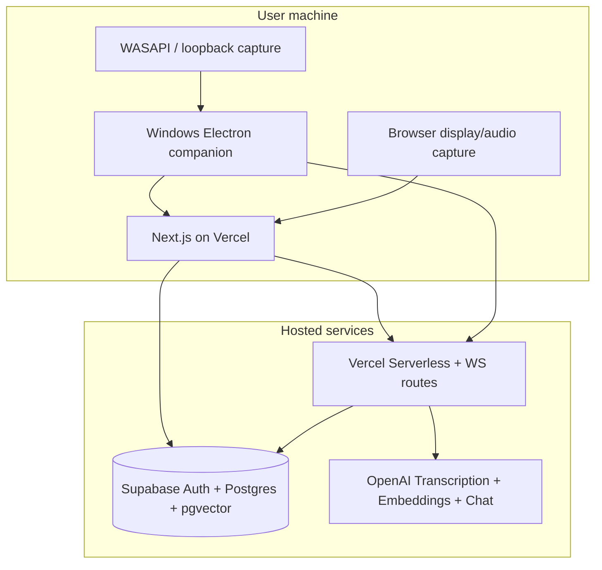

# Interview Copilot — Architecture

## Vision

Real-time interview assistant with **retrieval before generation**: prepared answers win over LLM prose; generation uses verified user background only when retrieval is insufficient.

## System context



Audio never uploads to Vercel by default for storage; streams go to OpenAI transcription via authenticated server-mediated sessions.

## Monorepo layout

```
interview-copilot/
├── apps/
│   ├── web/                 # Next.js 15 App Router, Tailwind, shadcn/ui
│   └── desktop/             # Electron main/preload, Windows loopback
├── packages/
│   └── shared/              # Zod schemas, types, match thresholds
├── supabase/
│   └── migrations/          # Schema, RLS, vector indexes
├── docs/
└── package.json             # npm workspaces
```

## Technology decisions

| Area | Choice | Rationale |
|------|--------|-----------|
| Web UI | Next.js 15, TypeScript, Tailwind, shadcn/ui | Vercel-native, fast iteration |
| Auth & DB | Supabase Auth + Postgres + pgvector | RLS, vectors, familiar DX |
| Embeddings | `text-embedding-3-small` (1536d) | Cost/latency balance |
| Transcription | OpenAI Realtime / streaming transcription API | Low latency, official protocol |
| Desktop | Electron 33+ with loopback where supported | User-initiated system audio on Windows |
| Monorepo | npm workspaces | Simple, no extra tooling |
| API keys | Server-only (`OPENAI_API_KEY`, service role never in client) | Security Phase 7 |

## Data model (summary)

- **profiles** — interview contexts (employer, role, job description, resume refs)
- **prepared_qa** — question, answer, category, preferred flag
- **experience_stories** — STAR stories, metrics, tags
- **documents** — uploaded files metadata + extracted text
- **document_chunks** — chunked text + embedding for RAG
- **embedding_index** — unified searchable rows (qa, story, chunk) with `content_type`, `source_id`
- **interview_sessions** — live session metadata, settings
- **transcript_segments** — optional persisted transcript (user setting)
- **session_events** — question detections, match results (audit)

All tables: `user_id` + RLS policies `auth.uid() = user_id`.

## Retrieval pipeline

1. Utterance finalized (VAD / manual analyze).
2. Embed utterance (same model as index).
3. `match_embeddings(query_embedding, threshold, limit)` via RPC.
4. Score blend: vector similarity + preferred boost + profile scope.
5. Outcomes: **PREPARED** (verbatim), **ADAPTED** (story + generate), **GENERATED** (JD + background, labeled).

## Real-time path

- Browser: `getDisplayMedia` + mic; video track discarded locally.
- Electron: separate process streams PCM to web via secure local bridge → same WS transcription route as browser.
- Server: short-lived session token; WebSocket or SSE proxy to OpenAI with reconnect + dedupe by `sequence_id`.

## Deployment

- **web**: Vercel, env validation at build.
- **desktop**: electron-builder, Windows x64.
- **supabase**: `supabase db push` or SQL migrations in repo.

## Milestones

| Phase | Deliverable |
|-------|-------------|
| 1 | Dashboard, CRUD, import, embeddings, semantic search |
| 2 | Capture UI + Electron skeleton + device health |
| 3 | Streaming transcription + simulation mode |
| 4 | Question detection + three outcome states |
| 5 | Live interview 3-panel UI + compact Electron window |
| 6 | Answer formats (full / 30s / bullets) |
| 7 | RLS, sanitization, no default audio persistence |
| 8 | Vercel + README + desktop package |
| 9 | Vitest/Playwright acceptance tests |

## Session sharing (web ↔ desktop)

Desktop opens web with Supabase session (PKCE); deep link `interview-copilot://auth/callback` or embedded login. Live session ID passed via query + validated server-side.
